# Zero-DCE-improved

  - [Vista general](#overview)
    - [Introducción](#introduction)
    - [Estructura de carpetas](#folder-structure)
  - [Inicio rápido](#quick-start)
    - [Prerrequisitos](#prerequisites)
    - [Entrenar](#train)
    - [Probar](#test)
  - [Mejora](#improvement)
    - [Análisis del problema](#problem-analysis)
    - [Mejora de la red](#network-improvement)
      - [Reducir parámetros](#reduce-parameters)
      - [Agregar capa de agrupamiento superpuesto](#add-overlapping-pooling-layer)
      - [Ajustar función de pérdida](#adjust-loss-function)
    - [Postprocesamiento de imágenes](#image-post-processing)
  - [Comparación de resultados](#comparison-of-results)
    - [Efecto de realce](#enhancement-effect)
      - [Efecto de la mejora](#improvement-effect)
      - [Efecto general](#overall-effect)
    - [Tamaño del modelo y velocidad de inferencia](#model-size--reasoning-speed)

## Vista general
### Introducción
Esta es la implementación de ***Zero-Reference Deep Curve Estimation for Low-Light Image Enhancement***, y los resultados de este artículo alcanzaron el estado del arte (SOTA) en ese momento. 

Basándonos en el método propuesto en el paper y en el código abierto proporcionado por el autor, hemos mejorado el efecto de realce de imágenes en condiciones de poca luz mediante la optimización del modelo y combinándolo con técnicas tradicionales, al mismo tiempo que reducimos el tamaño del modelo en cierta medida y aceleramos el entrenamiento y la inferencia.

### Estructura de carpetas
    src
    ├── data
    │   ├── result              # resultados realzados
    │   ├── test_data           # datos de prueba
    │   │   ├── LIME 
    │   │   └── DICM
    │   └── train_data          # datos para entrenamiento
    ├── lowlight_test.py        # código de prueba
    ├── lowlight_train.py       # código de entrenamiento
    ├── model.py                # red Zero-DEC
    ├── Myloss.py               # definición de la función de pérdida
    ├── dataloader.py           
    ├── runs                    # directorio para almacenar registros de entrenamiento
    └── snapshots               # directorio para almacenar los modelos
        └── pre-train.pth       # Un modelo preentrenado

## Inicio rápido
### Prerrequisitos
- Python 3.8
- CUDA 11.1

El paquete pip requerido para ejecutar el código se instala ejecutando el siguiente comando en `src`: 
``` bash
python -m pip install -r requirements.txt
```

### Entrenar
Puede cambiar los datos de entrenamiento modificando las imágenes almacenadas en `src/data/train_data`. 

Ejecute el siguiente comando para iniciar el entrenamiento:
``` bash
python lowlight_train.py 
```

Durante el proceso de entrenamiento, puede ejecutar los siguientes comandos para ver el progreso y los resultados en tiempo real a través de tensorboard:
``` bash
tensorboard --logdir=runs 
```

### Probar
Puede cambiar los datos de prueba modificando las imágenes almacenadas en `src/data/test_data`. Los resultados realzados se guardan en `src/data/result`.

Ejecute el siguiente comando para iniciar la prueba:
``` bash
python lowlight_test.py 
```

## Mejora
### Análisis del problema
Antes de comenzar a mejorar el trabajo original, primero reproducimos sus resultados y, mediante el análisis de las imágenes realzadas, resumimos los siguientes problemas que necesitan ser mejorados:
- **Brillo excesivo**: Algunas imágenes con grandes áreas de partes brillantes muestran un **brillo excesivo** en esas zonas después del realce, y las partes originalmente brillantes resultan demasiado claras.
- **Ruido**: En algunas imágenes con grandes áreas oscuras, aparece mucho **ruido** en las zonas oscuras después del realce.
- **Pérdida de detalles**: Tras el realce, los detalles de algunas imágenes se pierden notablemente.

||Ruido|Pérdida de detalles|Brillo excesivo|
|:-:|:-:|:-:|:-:|
|Original|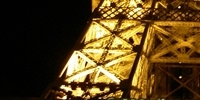|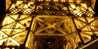|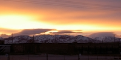|
|Realzado (original)|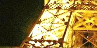|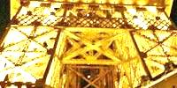|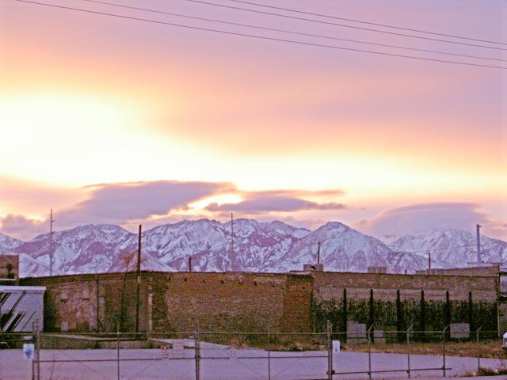|

### Mejora de la red
Actualmente, las tecnologías de realce de imágenes en condiciones de poca luz se utilizan ampliamente en los campos de la fotografía móvil y el realce de video, y tienen requisitos relativamente altos en cuanto a la velocidad de realce y el tamaño del modelo. Por lo tanto, además de mejorar el efecto de realce, también es necesario reducir al máximo el tamaño del modelo entrenado y aumentar la velocidad de procesamiento.

#### Reducir parámetros
El tamaño del modelo y la velocidad de entrenamiento y cálculo dependen casi por completo de la cantidad de parámetros y operaciones en el diseño de la red. Reduciendo el tamaño y el número de canales de la imagen de entrada de cada capa, el modelo puede reducirse efectivamente y la velocidad aumentarse. Sin embargo, este artículo diseña una curva específica para cada imagen. Mediante la aplicación repetida de sí misma, se puede ajustar una curva de orden superior y a nivel de píxel para completar el mapeo efectivo desde el color de píxeles en poca luz hasta el color en iluminación normal. Por lo tanto, al realizar la extracción de características, si elegimos comprimir el tamaño de la imagen de entrada, se perderá la información de color de muchos píxeles. Cuando el tamaño de la imagen se restaura mediante upsampling o deconvolución posterior, los detalles del contenido de la imagen se perderán o aparecerá mucho ruido y un borde blanco (como se muestra a continuación). Por lo tanto, en la parte de reducción de parámetros de la red, hemos optado por reducir el número de canales de entrada. El tamaño del modelo se comprime de los 316 KB originales a 97 KB. También se ha logrado una cierta mejora en la velocidad de entrenamiento y de realce.


|Borde blanco|Mucho ruido|
|:-:|:-:|
|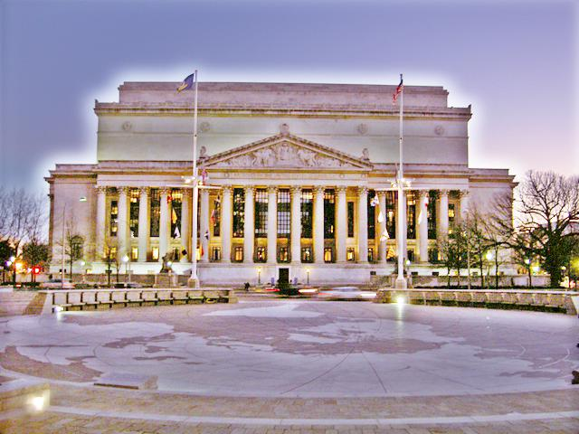|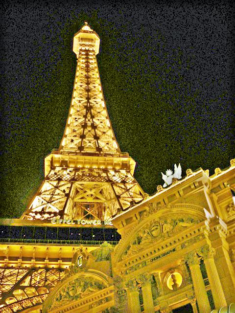|

#### Agregar capa de agrupamiento superpuesto
En general, podemos utilizar la capa de agrupamiento (pooling) o de subsampling para realizar la selección de características, reducir el número de características y, por consiguiente, reducir la cantidad de parámetros, lo que a su vez reduce el tamaño del modelo y aumenta la velocidad. Pero como mencionamos anteriormente, reducir el tamaño de la imagen de entrada no es un método recomendable en este enfoque, por lo que utilizamos un agrupamiento máximo superpuesto (overlap pooling) con un kernel de convolución de 3 y un stride de 1, añadido después de la tercera capa convolucional. (En las pruebas, descubrimos que demasiadas capas de pooling provocan problemas como la pérdida de detalles de la imagen y un aumento del ruido). La adición de esta capa de agrupamiento máximo superpuesto puede mejorar la precisión de la predicción y mitigar el sobreajuste (overfitting).

#### Ajustar función de pérdida
Este artículo establece una serie de funciones de pérdida sin referencia (pérdida de consistencia espacial, pérdida de control de exposición, pérdida de constancia del color, pérdida de suavidad de iluminación), de modo que la red pueda completar el entrenamiento extremo a extremo (e2e) sin necesidad de imágenes de referencia. Teniendo en cuenta el problema del ruido en la imagen realzada, aumentamos ligeramente el peso de $Loss_{tv}$ en la función de pérdida para incrementar la suavidad de la imagen y reducir el ruido en las zonas oscuras.

### Postprocesamiento de imágenes
El conjunto de datos de entrenamiento proporcionado en este artículo contiene imágenes subexpuestas, normalmente expuestas y sobreexpuestas. En cierta medida, el modelo final entrenado tenderá a producir imágenes sobreexpuestas. A partir del cambio en la pérdida durante el proceso de entrenamiento mostrado en la figura a continuación, podemos observarlo fácilmente. Aunque la pérdida converge en la tendencia general (Suavizado=0.99), incluso a las 200 épocas, aún mantiene fluctuaciones considerables.

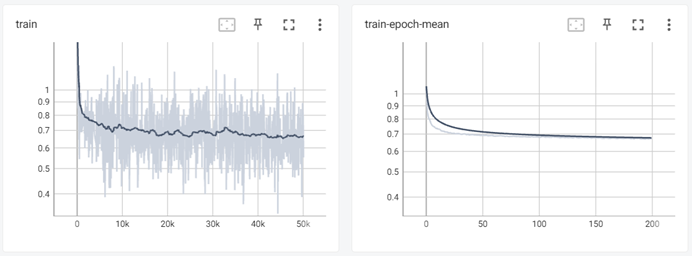

Con el fin de mejorar aún más el efecto de realce, hemos realizado ajustes adicionales basándonos en el trabajo anterior mediante métodos tradicionales. 

La transformación Gamma se utiliza principalmente para la corrección de imágenes, corrigiendo aquellas con niveles de gris demasiado altos o bajos para mejorar el contraste. De hecho, consiste en aplicar una operación de producto a cada valor de píxel de la imagen original. Debido a esta característica, se ha convertido en uno de los métodos tradicionales de realce de imágenes. Puede aplicarse tanto a imágenes en poca luz como a sobreexpuestas. Cuando $Gamma < 1$, estira las áreas de niveles de gris más bajos en la imagen y comprime las partes con niveles de gris más altos, lo que puede utilizarse para el realce de imágenes en poca luz. Cuando $Gamma > 1$, estira las áreas con niveles de gris más altos en la imagen y comprime los niveles de gris más bajos al mismo tiempo, lo que puede emplearse para mejorar imágenes sobreexpuestas.

## Comparación de resultados
### Efecto de realce
#### Efecto de la mejora
||Ruido|Pérdida de detalles|Brillo excesivo|
|:-:|:-:|:-:|:-:|
|Original||||
|Realzado (original)||||
|Mejorado|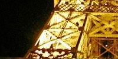|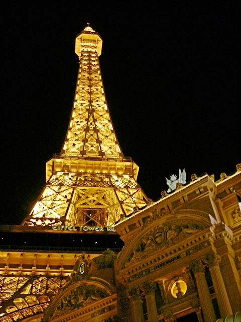||

#### Efecto general
|Imágenes originales|Resultados|
|:-:|:-:|
|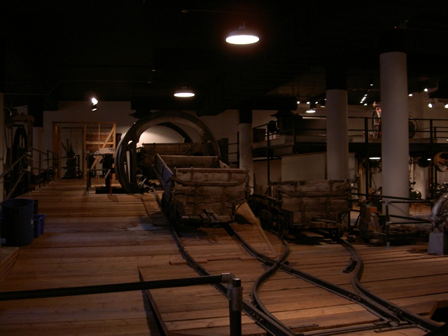|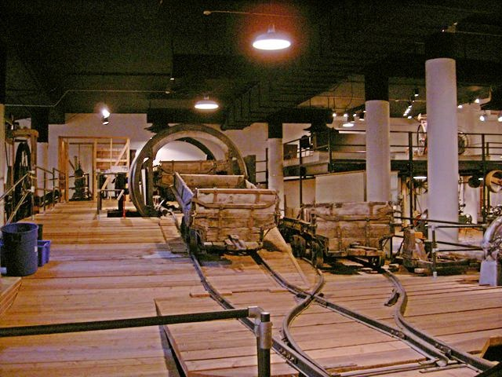|
|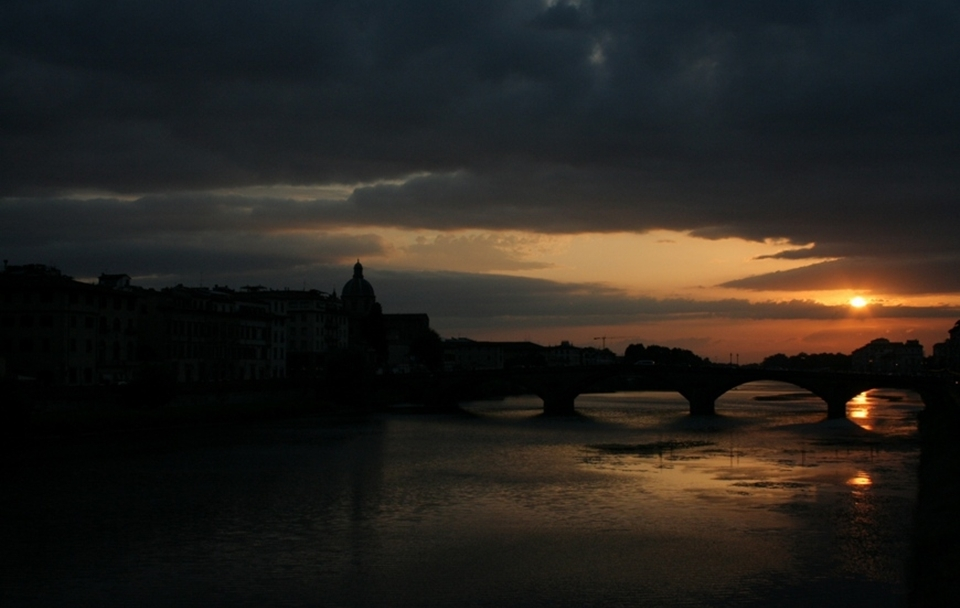|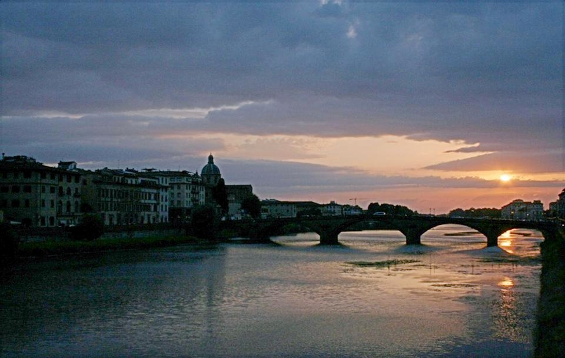|
|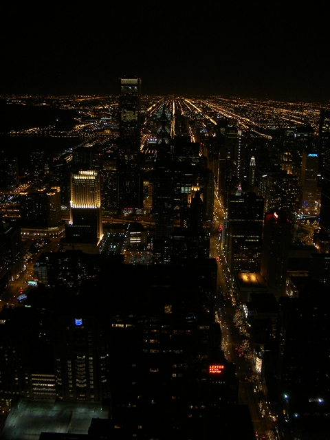|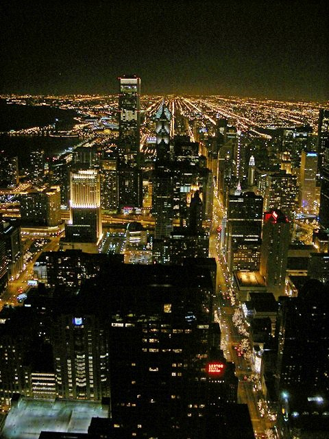|

### Tamaño del modelo y velocidad de inferencia
- Tamaño del modelo: El tamaño del archivo del modelo se comprimió de 312 KB ([archivo del modelo preentrenado oficial](https://github.com/Li-Chongyi/Zero-DCE/tree/ace3d87c5bb65327535d3ece06176bc160dea1eb/Zero-DCE_code/snapshots)) a 97 KB (`src/snapshots/*.pth`).
- Velocidad de inferencia: A continuación se muestra una comparación de la velocidad de realce de las 9 imágenes en `src/test_data/LIME` entre el modelo original y el modelo mejorado. Según los resultados, el modelo mejorado alcanza un ratio de optimización del 10-35%.

|Nombre del archivo|Tamaño/MB|Original/s|Mejorado/s||
|:-:|:-:|:-:|:-:|:-:|
|1.bmp|1.40|0.02394|0.01596|66.7%|
|2.bmp|0.67|0.01396|0.01197|85.7%|
|3.bmp|0.53|0.01197|0.00898|75.0%|
|4.bmp|0.43|0.00997|0.00798|80.0%|
|5.bmp|2.34|0.03890|0.03491|89.7%|
|6.bmp|0.30|0.00898|0.00598|66.6%|
|7.bmp|0.58|0.01296|0.00898|69.3%|
|8.bmp|0.52|0.01197|0.00898|75.0%|
|9.bmp|0.64|0.01396|0.01097|78.6%|
